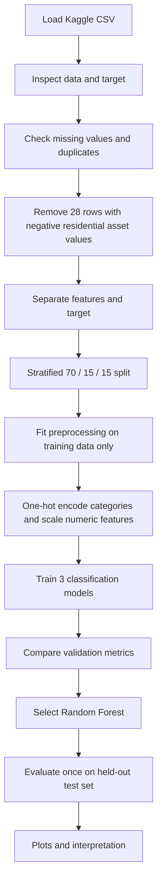

<div align="center">

# 🏦 Loan Approval Prediction Using Machine Learning

**Comparative Analysis of Machine Learning Models Using Categorical Feature Encoding and Model Evaluation**


[Overview](#-overview) · [Dataset](#-dataset) · [Workflow](#-machine-learning-workflow) · [Models](#-models-and-results) · [Feature Importance](#-feature-importance) · [Run the Project](#-run-the-project) · [Limitations](#-limitations)

</div>

> ⚠️ **Educational project only.** This model predicts labels in the selected dataset. It is not a banking decision system and must not be used to approve or reject real loan applications.

---

## ✨ Highlights

| 📚 Dataset | 🧹 Cleaning | 🤖 Models | 🏆 Best test accuracy |
|:---:|:---:|:---:|:---:|
| 4,269 original records | 28 rows removed | 3 classifiers | **98.90%** |

- Explores loan application data and the `Approved` / `Rejected` target classes.
- Checks missing values, duplicate records, and negative residential asset values.
- Uses a stratified **70% / 15% / 15%** train / validation / test split.
- Applies `StandardScaler` to numerical features and `OneHotEncoder` to categorical features.
- Compares Logistic Regression, Decision Tree, and Random Forest.
- Evaluates the selected Random Forest on a held-out test set and plots ROC, confusion matrix, feature importance, and learning curve.

## 🔍 Overview

The goal is to compare machine-learning classification models that predict the loan-status label in a public dataset. The notebook demonstrates a standard workflow: data inspection, cleaning, preprocessing, model comparison, evaluation, and interpretation.

| Item | Details |
|---|---|
| Task | Binary classification |
| Target | `loan_status` — `Approved` or `Rejected` |
| Identifier excluded from model input | `loan_id` |
| Original dataset shape | 4,269 rows × 13 columns |
| Rows after cleaning | 4,241 |
| Input features | 11 |
| Environment | Google Colab / Jupyter Notebook |

## 🗂 Dataset

**Source:** [Loan Approval Prediction Dataset on Kaggle](https://www.kaggle.com/datasets/architsharma01/loan-approval-prediction-dataset)

The notebook uses the dataset file `loan_approval_dataset.csv`. The original data contains 4,269 records and 13 columns, including the target `loan_status` and record identifier `loan_id`.

### Input features

| Feature | Description |
|---|---|
| `no_of_dependents` | Number of dependents |
| `education` | Graduate / Not Graduate |
| `self_employed` | Self-employment status |
| `income_annum` | Annual income |
| `loan_amount` | Requested loan amount |
| `loan_term` | Loan term |
| `cibil_score` | CIBIL credit score in the dataset |
| `residential_assets_value` | Residential asset value |
| `commercial_assets_value` | Commercial asset value |
| `luxury_assets_value` | Luxury asset value |
| `bank_asset_value` | Bank asset value |

`loan_status` is the target column; `loan_id` is excluded from the model features because it is an identifier.

## ⚙️ Machine Learning Workflow



### Data cleaning and preprocessing

- The dataset inspection found **0 missing values** and **0 duplicate rows**.
- **28 rows** with a negative `residential_assets_value` (`-100000`) were removed. This is a project-specific cleaning rule; it is not proof that every unusual financial value in any dataset is invalid.
- The cleaned dataset contains **4,241 rows**.
- `loan_id` is excluded from the features; `loan_status` is the target.
- Stratified split: 2,968 training rows, 636 validation rows, and 637 test rows.
- Numerical features are median-imputed (no missing values were observed) and standardized with `StandardScaler`.
- Categorical features are imputed with the most frequent value if needed, then transformed using `OneHotEncoder`.
- The preprocessor is fitted on training data and used to transform validation and test data, reducing the risk of data leakage.
- Target mapping used in modelling: `Rejected = 0`, `Approved = 1`.

## 🤖 Models and Results

### Validation-set comparison

These validation scores were observed in the notebook run:

| Model | Accuracy | Precision | Recall | F1-score | ROC-AUC |
|---|---:|---:|---:|---:|---:|
| Logistic Regression | 0.9230 | 0.9437 | 0.9318 | 0.9377 | 0.9660 |
| Decision Tree | 0.9780 | 0.9848 | 0.9798 | 0.9823 | 0.9774 |
| **Random Forest** | **0.9811** | **0.9848** | **0.9848** | **0.9848** | **0.9974** |

Random Forest was selected based on its validation performance. Its performance was then evaluated on the held-out test set.

### Random Forest — final test-set results

| Metric | Test score |
|---|---:|
| Accuracy | **0.9890 (98.90%)** |
| Precision | 0.9875 (98.75%) |
| Recall | 0.9949 (99.49%) |
| F1-score | 0.9912 (99.12%) |
| ROC-AUC | 0.9981 |

The test set contained 637 records. These figures describe performance on this dataset split only; they do not demonstrate that the same performance will hold on other datasets or real banking applications.

## 📊 Feature Importance

The notebook's Random Forest impurity-based importance values were:

| Feature | Importance |
|---|---:|
| `cibil_score` | 0.8181 |
| `loan_term` | 0.0568 |
| `loan_amount` | 0.0293 |
| `luxury_assets_value` | 0.0181 |
| `income_annum` | 0.0172 |
| `commercial_assets_value` | 0.0166 |
| `bank_asset_value` | 0.0154 |
| `residential_assets_value` | 0.0153 |
| `no_of_dependents` | 0.0083 |
| `self_employed` | 0.0026 |
| `education` | 0.0021 |

`cibil_score` has the largest importance value in this trained model. Feature importance describes how the model uses features; it does not establish cause and effect or universal lending rules.

## 📈 Visual Analysis Included

The notebook generates:

- Loan-status class distribution chart.
- Boxplots for selected numeric features to inspect potential outliers.
- Validation accuracy comparison for the three models.
- Validation ROC curves for model comparison.
- Final test confusion matrix and ROC curve for Random Forest.
- Random Forest feature-importance chart.
- Random Forest learning curve using cross-validation on the training portion.

In the learning curve, training accuracy is close to 1.00 while cross-validation accuracy rises to roughly 0.976 at the largest training size, indicating a remaining train/validation gap worth monitoring.

## 🚀 Run the Project

### Option 1 — Google Colab (recommended)

1. Open the `.ipynb` notebook in Google Colab.
2. Run the cells from top to bottom in order.
3. When prompted, upload the Kaggle ZIP archive containing `loan_approval_dataset.csv` or upload the CSV itself.
4. Review the cleaning summary, validation comparison, test metrics, and plots.
5. Run the optional Gradio demo cell to create an interactive prediction form during the active Colab session.

**Note:** A Gradio share link is temporary and depends on the Colab session staying active. It is not a permanently hosted application.

### Option 2 — Run locally

Install the core libraries in a Python environment:

```bash
pip install pandas numpy scikit-learn matplotlib seaborn gradio joblib jupyter
```

Open the notebook in Jupyter and adapt the file-upload cell to read the CSV from a local path. Cells that import `google.colab` are specific to Colab and need to be skipped or adjusted for local use.

## 🧰 Tech Stack

- **Language:** Python
- **Data handling:** pandas, NumPy
- **Machine learning:** scikit-learn
- **Visualisation:** Matplotlib, Seaborn
- **Interactive demo:** Gradio (optional)
- **Notebook environment:** Google Colab / Jupyter

## ⚠️ Limitations

- The model is trained and evaluated on one dataset and one held-out split.
- The unusually high scores should be interpreted in the context of this dataset and its target patterns; independent validation is required before broader claims.
- Feature importance is not causal explanation.
- The demo is educational, not a real lending decision tool. Do not input real applicants' sensitive information.
- Dataset licence and permitted redistribution should be checked on the original Kaggle page before redistributing the CSV.

## 📁 Suggested Repository Structure

```text
loan-approval-prediction/
├── README.md
├── Loan_Approval_Prediction.ipynb
└── loan_approval_final_results.csv
```

## 📌 Conclusion

This project demonstrates a complete supervised machine-learning workflow for a loan-status classification dataset, from data inspection and preprocessing to validation, held-out testing, and interpretation. Random Forest performed best among the three compared models in the observed validation run and achieved 98.90% test accuracy on the held-out split. The results are dataset-specific and should not be treated as evidence of real-world banking performance.

---

<div align="center">

**Built as an educational Machine Learning project.**

</div>
