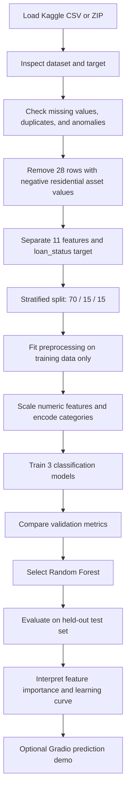

<div align="center">

# 🏦 Loan Approval Prediction Using Machine Learning

**Three models. One stratified split. 4,269 loan applications.**  
A machine learning project comparing classification algorithms for predicting the `Approved` / `Rejected` loan-status label, with categorical encoding, model evaluation, and an interactive demo.

[](https://colab.research.google.com/github/Sadik-Hasan1/loan-approval-prediction/blob/main/Loan_Approval_Prediction_%20(1).ipynb)
[](https://www.python.org/)
[](https://pandas.pydata.org/)
[](https://scikit-learn.org/)
[](https://colab.research.google.com/)
[](https://www.gradio.app/)
[](https://jupyter.org/)

[Highlights](#-highlights) · [Dataset](#-dataset) · [Workflow](#-machine-learning-workflow) · [Models](#-models) · [Results](#-results) · [Feature Importance](#-feature-importance) · [Quick Start](#-quick-start) · [Limitations](#-limitations-and-future-work)

</div>

> ⚠️ **Educational project only.** This model predicts labels in the selected dataset. It is not a bank approval system and must not be used to make real lending decisions or to assess actual applicants.

---

## ✨ Highlights

| 📚 Dataset | 🧹 Cleaning | 🤖 Models compared | 🏆 Random Forest test accuracy |
|:---:|:---:|:---:|:---:|
| **4,269** original records | **28** records removed | **3** classifiers | **98.90%** |

- 📊 Explores the `Approved` / `Rejected` target distribution and applicant features.
- 🧹 Checks missing values, duplicate records, negative asset values, and potential outliers.
- 🔀 Uses a stratified **70% / 15% / 15%** train / validation / test split.
- 🔠 Uses `OneHotEncoder` for categorical features and `StandardScaler` for numerical features.
- ⚖️ Compares Logistic Regression, Decision Tree, and Random Forest using validation metrics.
- 🧪 Evaluates the selected Random Forest on a held-out test set.
- 📈 Includes a class distribution chart, outlier boxplots, validation ROC curves, a test confusion matrix and ROC curve, feature importance, and a learning curve.
- 🖥️ Includes an optional Gradio form for interactive predictions during a running Colab session.

## 📚 Table of Contents

- [Overview](#-overview)
- [Dataset](#-dataset)
- [Machine Learning Workflow](#-machine-learning-workflow)
- [Data Cleaning and Preprocessing](#-data-cleaning-and-preprocessing)
- [Models](#-models)
- [Results](#-results)
- [Key Findings](#-key-findings)
- [Feature Importance](#-feature-importance)
- [Visual Analysis](#-visual-analysis)
- [Quick Start](#-quick-start)
- [Repository Structure](#-repository-structure)
- [Tech Stack](#-tech-stack)
- [Limitations and Future Work](#-limitations-and-future-work)
- [Conclusion](#-conclusion)
- [Author](#-author)
- [Acknowledgements](#-acknowledgements)

## 🔍 Overview

| Item | Details |
|---|---|
| **Task** | Binary classification of loan application status |
| **Target** | `loan_status` (`Approved` or `Rejected`) |
| **Identifier excluded from features** | `loan_id` |
| **Original dataset** | 4,269 rows × 13 columns |
| **Dataset after cleaning** | 4,241 rows |
| **Input features** | 11 before categorical encoding |
| **Training environment** | Google Colab / Jupyter Notebook |
| **Best model by validation results** | Random Forest |

The goal is to demonstrate an end-to-end classification workflow: inspect the data, clean selected anomalies, prepare features, compare models, evaluate the selected model, and interpret its output. Reported scores apply to this dataset and split only.

## 🗂 Dataset

The notebook uses `loan_approval_dataset.csv` from the Kaggle dataset page:

🔗 **Dataset source:** [Loan Approval Prediction Dataset — Kaggle](https://www.kaggle.com/datasets/architsharma01/loan-approval-prediction-dataset)

The original file has **4,269 records and 13 columns**, including the target `loan_status` and identifier `loan_id`. The target classes observed in the supplied run were 2,656 `Approved` and 1,613 `Rejected` before cleaning.

### Input features

| Feature | Description |
|---|---|
| `no_of_dependents` | Number of dependents |
| `education` | Education category: Graduate / Not Graduate |
| `self_employed` | Whether the applicant is self-employed |
| `income_annum` | Annual income in the dataset |
| `loan_amount` | Requested loan amount in the dataset |
| `loan_term` | Loan term value in the dataset |
| `cibil_score` | CIBIL score field provided in the dataset |
| `residential_assets_value` | Residential asset value |
| `commercial_assets_value` | Commercial asset value |
| `luxury_assets_value` | Luxury asset value |
| `bank_asset_value` | Bank asset value |

**Target:** `loan_status` — `Approved` / `Rejected`.  
**Excluded identifier:** `loan_id` is not used as a predictive feature.

Please refer to the original Kaggle page for dataset ownership, license, and permitted usage before redistributing the source data.

## ⚙️ Machine Learning Workflow



## 🧹 Data Cleaning and Preprocessing

- Initial inspection found **0 missing values** and **0 duplicate rows** in the original dataset.
- There were **28 records** with negative `residential_assets_value` values (all shown as `-100000`). These records were removed for this project, leaving **4,241 rows**. This is a project-specific data-cleaning choice, not proof that every unusual value in another dataset is invalid.
- The IQR rule flagged potential outliers in some asset columns. Those values were not automatically removed, because a statistical outlier is not necessarily a data-entry error.
- `loan_id` was excluded from the input features. `loan_status` was used as the target.
- The cleaned data was split with `random_state=42` and stratification:

| Subset | Records | Share |
|---|---:|---:|
| Training | 2,968 | 70% |
| Validation | 636 | 15% |
| Test | 637 | 15% |
| **Total** | **4,241** | **100%** |

- Numerical features were processed with median imputation and `StandardScaler`. No missing values were observed, so the imputer did not need to fill values in the current dataset.
- Categorical features were processed with most-frequent imputation and `OneHotEncoder`.
- The preprocessing transformer was fitted on training data and then used to transform validation and test data, reducing the risk of data leakage.
- Target mapping: `Rejected = 0`, `Approved = 1`.

## 🤖 Models

Three classifiers were trained using the processed features:

| Model | Configuration used in the notebook |
|---|---|
| Logistic Regression | `max_iter=1000`, `random_state=42` |
| Decision Tree | `random_state=42` |
| Random Forest | `n_estimators=200`, `random_state=42`, `n_jobs=-1` |

The validation set was used to compare the models. Random Forest had the strongest overall validation results in the recorded run and was selected for the final test evaluation.

## 📊 Results

### Validation-set model comparison

Scores below are from the validation set and were recorded in the notebook run.

| Model | Accuracy | Precision | Recall | F1-score | ROC-AUC |
|---|---:|---:|---:|---:|---:|
| Logistic Regression | 0.9230 | 0.9437 | 0.9318 | 0.9377 | 0.9660 |
| Decision Tree | 0.9780 | 0.9848 | 0.9798 | 0.9823 | 0.9774 |
| **Random Forest** | **0.9811** | **0.9848** | **0.9848** | **0.9848** | **0.9974** |

### Random Forest — final test-set evaluation

The selected Random Forest was evaluated on the held-out test set of **637 records**.

| Metric | Test score |
|---|---:|
| Accuracy | **0.9890 (98.90%)** |
| Precision | 0.9875 (98.75%) |
| Recall | 0.9949 (99.49%) |
| F1-score | 0.9912 (99.12%) |
| ROC-AUC | 0.9981 |

These are the observed scores from this notebook run. They do **not** demonstrate that the same performance will hold for other datasets or real banking applications. The high scores warrant independent validation on other data before broader claims are made.

## 💡 Key Findings

1. **Random Forest performed best on the validation set** among the three tested models, with 98.11% accuracy, an F1-score of 0.9848, and ROC-AUC of 0.9974.
2. **The held-out test result was also high:** Random Forest achieved 98.90% accuracy, 98.75% precision, 99.49% recall, 99.12% F1-score, and 0.9981 ROC-AUC on 637 test records.
3. **CIBIL score dominated the trained Random Forest's feature-importance ranking**, with an impurity-based importance value of 0.8181. This is a model-specific association, not evidence of causation or a universal lending rule.
4. **Some overfitting may remain.** The recorded learning curve showed training accuracy close to 1.00 and cross-validation accuracy reaching approximately 0.976 at the largest training size.
5. **The results are specific to this dataset and split.** The high scores should be checked with independent data before making claims about performance on real loan applications.
6. **The cleaning decision was limited and explicit:** 28 records with negative residential asset values were removed, leaving 4,241 records; potential IQR outliers in other asset columns were not automatically deleted.

## 🏆 Feature Importance

The Random Forest's impurity-based feature importance values from the recorded run were:

| Rank | Feature | Importance |
|:---:|---|---:|
| 1 | `cibil_score` | **0.8181** |
| 2 | `loan_term` | 0.0568 |
| 3 | `loan_amount` | 0.0293 |
| 4 | `luxury_assets_value` | 0.0181 |
| 5 | `income_annum` | 0.0172 |
| 6 | `commercial_assets_value` | 0.0166 |
| 7 | `bank_asset_value` | 0.0154 |
| 8 | `residential_assets_value` | 0.0153 |
| 9 | `no_of_dependents` | 0.0083 |
| 10 | `self_employed` (encoded) | 0.0026 |
| 11 | `education` (encoded) | 0.0021 |

`cibil_score` had the largest importance value in this trained model. Feature importance describes how the model used features; it does not establish cause and effect, fairness, or universal lending rules.

## 📈 Visual Analysis

The notebook generates the following visualisations:

- Loan-status class distribution.
- Boxplots to inspect possible outliers in numeric features.
- Validation accuracy comparison across the three classifiers.
- ROC curves for the three models on the validation set.
- Confusion matrix and ROC curve for Random Forest on the held-out test set.
- Random Forest feature-importance chart.
- Learning curve showing training accuracy and cross-validation accuracy.

In the recorded learning curve, training accuracy stayed close to **1.00**, while cross-validation accuracy rose from approximately **0.961** at the smallest training size to approximately **0.976** at the largest size. The gap suggests that some overfitting remains worth monitoring. The learning-curve model uses 100 trees and 5-fold cross-validation, while the final Random Forest uses 200 trees.

## 🚀 Quick Start

### Option 1 — Google Colab (recommended)

1. Open the notebook in Google Colab using the badge at the top of this README (the repository must be accessible to your account).
2. Download the dataset from [Kaggle](https://www.kaggle.com/datasets/architsharma01/loan-approval-prediction-dataset).
3. Run the notebook cells from top to bottom in order.
4. When prompted, upload either the Kaggle ZIP archive that contains `loan_approval_dataset.csv` or the CSV file directly.
5. Review the cleaning summary, validation table, final test metrics, and generated plots.
6. To try the interactive form, run the optional Gradio installation and demo cells near the end of the notebook.

**Gradio note:** the share link created by Colab is temporary and depends on the session remaining active. This notebook does not represent a permanently hosted application.

### Option 2 — Run locally

Install the main packages in a Python environment:

```bash
pip install pandas numpy scikit-learn matplotlib seaborn gradio joblib jupyter
```

Open the `.ipynb` file in Jupyter. The notebook includes `google.colab` upload/download code, so those cells must be adapted for local file paths if running outside Colab.

## 🧰 Tech Stack

- **Language:** Python 3
- **Data handling:** pandas, NumPy
- **Machine learning:** scikit-learn
- **Preprocessing:** `ColumnTransformer`, `Pipeline`, `SimpleImputer`, `StandardScaler`, `OneHotEncoder`
- **Visualisation:** Matplotlib, Seaborn
- **Interactive demo:** Gradio (optional)
- **Notebook environment:** Google Colab / Jupyter Notebook

## 📁 Repository Structure

The repository should contain files similar to the following (names can vary if you kept the original notebook filename):

```text
loan-approval-prediction/
├── README.md
├── Loan_Approval_Prediction_ (1).ipynb
└── loan_approval_final_results.csv
```

The dataset CSV/ZIP is downloaded separately from Kaggle by default; check its license before committing or redistributing it in the repository.

## ⚠️ Limitations and Future Work

### Limitations

- The results come from one dataset and one stratified hold-out split; performance on independent data has not been established.
- The unusually high scores are dataset-specific and should be independently verified. They should not be generalised to real-world lending.
- Feature importance is not a causal explanation and is not a fairness assessment.
- The model does not implement a bank's actual underwriting policy and must not decide real loan applications.
- The Gradio demo is temporary when run through a Colab share link.
- The dataset's license and terms should be checked on Kaggle before redistributing the original data.

### Future work

- Evaluate with repeated or nested cross-validation where appropriate.
- Inspect model errors and performance across relevant applicant groups, subject to data and privacy constraints.
- Add calibration and threshold analysis if probabilities will be discussed.
- Test on an independent dataset before considering any wider claims.
- Deploy a persistent demo only after reviewing data, security, and model limitations.

## 📌 Conclusion

This project demonstrates a complete supervised-learning workflow for loan-status classification, from data inspection and cleaning through categorical encoding, model comparison, held-out testing, and interpretation. Random Forest achieved the strongest validation results among the three tested models and recorded **98.90% test accuracy** on the held-out split. The results are specific to the selected dataset and should not be treated as evidence of real-world banking performance.

---

## 👤 Author

**Sadik Hasan**  
GitHub: [@Sadik-Hasan1](https://github.com/Sadik-Hasan1)  
Repository: [loan-approval-prediction](https://github.com/Sadik-Hasan1/loan-approval-prediction)

> If this is a team submission, add the other contributors and their roles here before submitting.

## 🙏 Acknowledgements

- **Dataset:** [Loan Approval Prediction Dataset](https://www.kaggle.com/datasets/architsharma01/loan-approval-prediction-dataset) hosted on Kaggle. The dataset is used for educational machine-learning experimentation; refer to the original Kaggle page for the uploader's attribution, license, and usage terms.
- **Libraries:** [pandas](https://pandas.pydata.org/) and [NumPy](https://numpy.org/) for data handling; [scikit-learn](https://scikit-learn.org/) for preprocessing, classification, and evaluation; [Matplotlib](https://matplotlib.org/) and [Seaborn](https://seaborn.pydata.org/) for visualisation; and [Gradio](https://www.gradio.app/) for the optional interactive demo.
- **Development environment:** [Google Colab](https://colab.research.google.com/) and [Jupyter Notebook](https://jupyter.org/) for executing and documenting the workflow.
- **Documentation:** Official documentation for the libraries above was used as a reference for their APIs and usage.

---

<div align="center">

**Built as an educational Machine Learning project.**

</div>
